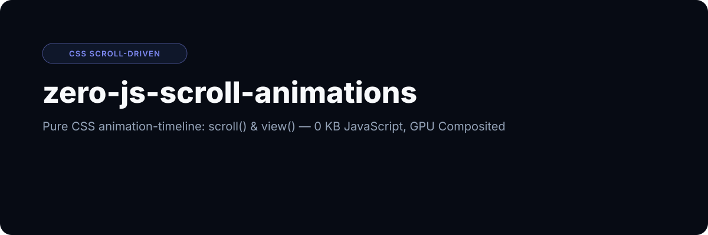
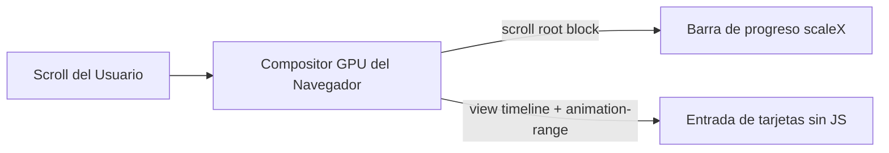

<p align="right">
  <a href="./README.md">🇺🇸 Read in English</a>
</p>

<p align="center">
  
</p>

<p align="center">
  
  
  
</p>

# zero-js-scroll-animations

Patrones listos para usar de **animaciones ligadas al scroll en CSS puro** usando `animation-timeline: scroll()` y `animation-timeline: view()`, ejecutándose en el compositor GPU sin ocupar el hilo principal de JavaScript.

---

## Cómo funciona



---

## Inicio rápido

Abre `index.html` directamente en tu navegador o sírvelo localmente:

```bash
npx serve .
```

---

## Referencias

- [MDN Web Docs — CSS Scroll-driven Animations](https://developer.mozilla.org/en-US/docs/Web/CSS/CSS_scroll-driven_animations)
- [Chrome for Developers — Animate Elements on Scroll with Scroll-driven Animations](https://developer.chrome.com/docs/css-ui/scroll-driven-animations)
