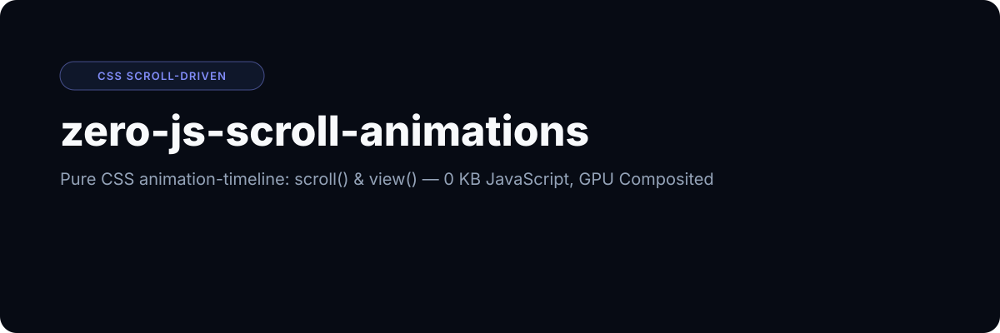

<p align="right">
  <a href="./README.es.md">🇪🇸 Leer en Español</a>
</p>

<p align="center">
  
</p>

<p align="center">
  
  
  
</p>

# zero-js-scroll-animations

Ready-to-copy **pure CSS Scroll-Driven Animations** using `animation-timeline: scroll()` and `animation-timeline: view()`—running off the main JavaScript thread on the browser compositor for silky 120Hz performance.

---

## How It Works

```mermaid
flowchart LR
    Scroll["User Scroll Gesture"] --> Comp["Browser Compositor Thread"]
    Comp -->|scroll(root block)| Bar["Progress Bar scaleX()"]
    Comp -->|view() + animation-range| Cards["Card Reveal Transform & Opacity"]
```

---

## Quick Start

Open `index.html` directly in any modern Chromium/Safari/Firefox browser or serve locally:

```bash
npx serve .
```

---

## References

- [MDN Web Docs — CSS Scroll-driven Animations](https://developer.mozilla.org/en-US/docs/Web/CSS/CSS_scroll-driven_animations)
- [Chrome for Developers — Animate Elements on Scroll with Scroll-driven Animations](https://developer.chrome.com/docs/css-ui/scroll-driven-animations)
